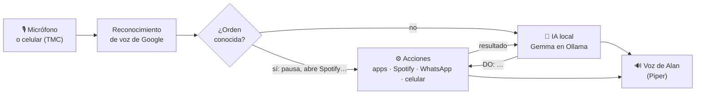

<div align="center">

# TALOS

**Asistente de voz para Windows que entiende lo que le pides y lo hace.**

Le hablas en español o en inglés, razona con una IA que corre en tu propia PC y controla
tus apps, tu música, tu WhatsApp y hasta tu celular.


</div>

---

## Qué hace

| | |
|---|---|
| 🗣️ **Habla contigo** | Dices "Talos" o "Jarvis" (o aplaudes, o haces clic en el anillo) y te escucha. Entiende español e inglés y responde en voz alta. Después de contestar sigue escuchando, sin que tengas que volver a llamarlo. |
| 🧠 **Razona, no solo obedece** | No hace falta decir órdenes exactas. Una IA local (Gemma en Ollama) entiende lo que quieres, elige las acciones y, si algo falla, lo intenta de otra forma. |
| 🖥️ **Controla tu PC** | Abre y cierra cualquier app, carpeta o página, escribe, pulsa teclas, hace clic en botones por su nombre, busca archivos y maneja ventanas. |
| 👀 **Mira tu pantalla** | "¿Qué estoy viendo?": toma una captura y te la explica. Puedes seguir preguntando sobre ella. |
| 🎵 **Spotify** | Busca y pone canciones, pausa, cambia de tema y sube o baja el volumen de Spotify sin tocar el del resto. |
| 💬 **WhatsApp** | Se conecta directo a WhatsApp como un dispositivo vinculado (con [neonize](https://github.com/krypton-byte/neonize)): encuentra el chat o grupo aunque digas el nombre a medias, redacta el mensaje y lo envía en menos de un segundo. También manda **notas de voz reales** con su propia voz y te avisa de los mensajes que llegan. Siempre pide confirmación antes de enviar. |
| 📱 **Tu celular** | Con [**TMC**](#-talos-mobile-connection-tmc) le hablas desde el teléfono, y TALOS controla la música del celular, contesta y cuelga llamadas y te avisa de los mensajes. |
| 🎮 **Modo gamer** | Cierra lo que consume recursos en segundo plano y libera la IA de la memoria. La "noche de juegos" además abre tu juego. |

## 🤖 Bot de WhatsApp

Cualquiera de tus contactos puede escribir **`.talos`** o **`.jarvis`** en el chat y TALOS le contesta solo:

- `.jarvis` a secas → *"Yes, Ana?"*
- `.talos ¿cómo estás?` → TALOS responde como en una conversación normal, en el idioma de la persona.
- Desde ese momento sigue conversando con esa persona sin que tenga que volver a llamarlo.
- Entiende **notas de voz**: las transcribe y contesta; si no entiende el audio, lo dice.
- **Ve las fotos, stickers y videos** que le mandan y los comenta (de un video mira un cuadro del medio).
- También entiende cuando **responden a una foto, un audio o un mensaje** anterior: mira esa foto, transcribe ese audio o lee ese mensaje.
- Contesta **citando** cada mensaje, así en un grupo se ve a quién le responde.
- No te interrumpe: los chats activos y lo que responde a cada uno se ven en una ventana aparte, *Bot de WhatsApp*, y mientras piensa la persona ve "escribiendo…".
- Se termina cuando dices **"stop"** (todos los chats) o solo uno: *"deja de responderle a Ana"*, *"para el chat con el grupo de fútbol"*, cuando la persona escribe `.stop`, o tras 30 minutos sin mensajes.

Tú mandas: si escribes `.talos <orden>` en un chat (por ejemplo *".talos dile a Ana que llego tarde"*), el bot
la cumple ahí mismo. Y nunca se burla de ti, aunque se lo pidan.

Por seguridad, en estas conversaciones TALOS solo charla: no ejecuta nada en tu PC, no cuenta tus datos y no
promete nada por ti. Pon tu nombre en `OWNER_NAME` para que diga de parte de quién habla.

## 📱 TALOS Mobile Connection (TMC)

TALOS se puede usar con **[TMC](https://github.com/LAJT-A/TALOS-Mobile-Connection)**, su app de Android.
El celular se conecta a la PC por **Bluetooth**, así que no necesita Wi-Fi ni datos.

- Toca **HABLAR** y dale órdenes a TALOS desde el teléfono; la respuesta suena en el celular con la misma voz.
- La PC controla la música del celular, su volumen y las llamadas ("contesta", "cuelga").
- Cuando te llaman o te escriben por WhatsApp, TALOS te avisa.
- Menú con todas las apps de tu PC, con sus logos, para abrirlas con un toque.

## Cómo funciona



Las órdenes simples van directo, para que respondan al instante. Todo lo demás lo piensa la IA:
escribe las acciones que quiere hacer (`DO: open spotify`), TALOS las ejecuta y le devuelve el
resultado, y la IA corrige el rumbo si algo no salió.

## Instalación

Necesitas **Windows 10 u 11**, **[Python 3.12](https://www.python.org/downloads/)**,
**[Ollama](https://ollama.com/download)** y unos 20 GB libres para la IA. Para usar la IA con
soltura conviene tener 32 GB de RAM.

```bat
git clone https://github.com/LAJT-A/TALOS.git
cd TALOS
scripts\instalar.bat
```

`instalar.bat` crea el entorno de Python, instala las librerías, descarga la voz y la IA, y crea
tu archivo de ajustes personales. Después, abre TALOS con:

```bat
scripts\talos.bat
```

### WhatsApp

La primera vez que abres TALOS aparece un código QR: escanéalo desde *WhatsApp → Dispositivos vinculados →
Vincular un dispositivo*. La sesión queda en `whatsapp.db`, que da acceso completo a tu cuenta: no la
compartas ni la subas a ningún lado.

> neonize no es un cliente oficial de WhatsApp. Úsalo para tus propios mensajes; WhatsApp puede suspender
> cuentas que hacen spam o usan clientes no oficiales.

## Ajustes

Los ajustes generales están al principio de [`talos.py`](talos.py). Los tuyos (micrófono, apodos de
tus contactos, código de país…) van en `ajustes_locales.py`, que no se sube a GitHub. Hay un
ejemplo en [`ajustes_locales.example.py`](ajustes_locales.example.py).

Para encontrar el número de tu micrófono:

```bat
venv\Scripts\python -c "import sounddevice as sd; print(sd.query_devices())"
```

## Ejemplos

| Dices | TALOS |
|---|---|
| "Talos, abre Visual Studio Code" | Lo abre, aunque digas "vscode". |
| "Busca en Spotify la nave del olvido y ponle play" | La busca y la pone. |
| "¿Qué hay en mi pantalla?" | Toma una captura y te la describe. |
| "Abre el bloc de notas y escribe una lista de compras" | Encadena las dos cosas. |
| "Dile al grupo de fútbol que llego tarde" | Encuentra el grupo, escribe el mensaje y te pide confirmación. |
| "Mándale un audio a Ana saludándola" | Graba una nota de voz con su voz y la envía. |
| "Pasa la canción en el cel" | Siguiente canción en el teléfono (con TMC). |
| "Activa el modo gamer" | Cierra las apps de fondo y libera memoria. |
| "Gracias" | Cierra la conversación. |

## Estructura

```
TALOS/
├── talos.py                     # el asistente: escucha, IA, acciones
├── comandos.py                  # entiende frases en español e inglés y las pasa a órdenes
├── telefono.py                  # enlace Bluetooth con TMC
├── whatsapp.py                  # conexión directa con WhatsApp (neonize)
├── ui.py                        # el anillo de luz en pantalla
├── ajustes_locales.example.py   # plantilla de tus ajustes personales
├── requirements.txt
└── scripts/
    ├── instalar.bat             # instalación completa
    ├── talos.bat                # abre TALOS
    └── iconos.ps1               # saca los logos de tus apps para el menú de TMC
```

## Privacidad

- **La IA corre en tu PC.** Las preguntas, las capturas de pantalla y lo que TALOS decide hacer no salen de tu equipo.
- **El reconocimiento de voz es de Google**, así que el audio de lo que dices se envía a Google para convertirlo en texto.
- **Los mensajes de WhatsApp** solo se envían después de que confirmas en voz alta.

## Créditos

Empezó a partir de [Local_AI_agent](https://github.com/ARAVIND988hh/Local_AI_agent) y se reescribió
casi por completo. La voz es [Piper](https://github.com/rhasspy/piper) con el modelo *en_GB-alan-medium*.

## Licencia

[MIT](LICENSE)
